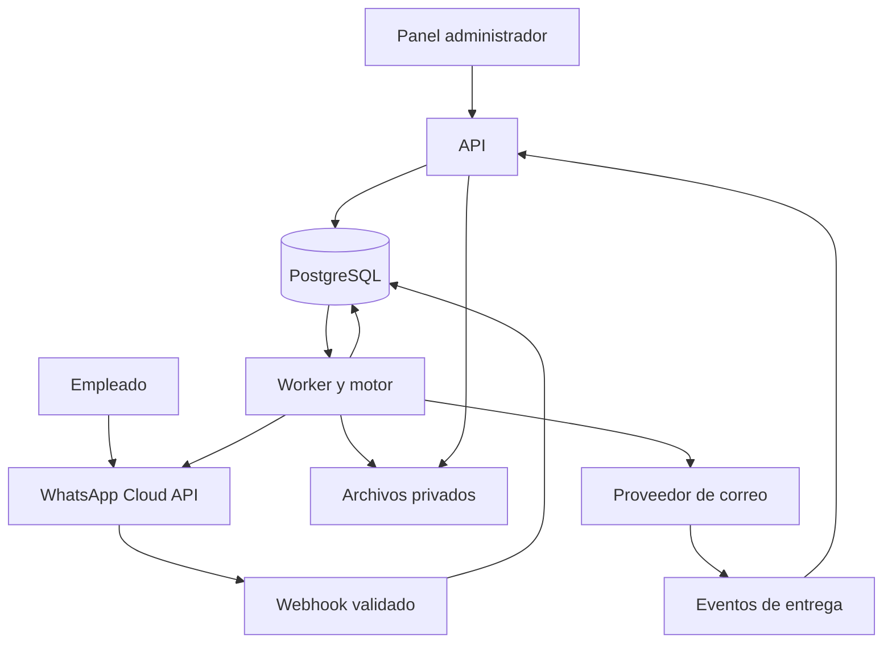

# Arquitectura del sistema de chatbot documental

Versión 1.0 · 14 de octubre de 2026 · Propuesta para iniciar desarrollo
Versión 1.1 · 19 de octubre de 2026 · Actualizada con los ADR de P0 (`docs/adr/`). Si este documento y un ADR aceptado difieren, prevalece el ADR.

## 1. Objetivo y alcance

Construir un sistema empresarial donde un administrador configure visualmente recorridos de WhatsApp. El empleado selecciona opciones, entrega datos y adjunta documentos. El sistema valida los archivos, determina destinatarios mediante reglas autorizadas y envía correos, con seguimiento y recuperación ante fallos.

Primera versión: una organización propietaria, varias empresas internas, un número empresarial de WhatsApp, conversaciones individuales y un trámite activo por empleado y número. No requiere IA. El editor admite únicamente bloques definidos y seguros, no código arbitrario.

Supuestos: volumen inicial bajo o medio; datos potencialmente sensibles; empleados identificados previamente; proveedor de correo y política de conservación pendientes. Si el bot debe atender externos, se diseña un proceso de alta distinto. Esta propuesta no certifica seguridad ni rendimiento: los objetivos deben validarse con pruebas.

## 2. Decisión principal

Monolito modular en TypeScript con dos procesos desplegables: API y worker. Comparten módulos de dominio y PostgreSQL, pero el worker realiza las tareas lentas. El motor de recorridos es independiente del editor, WhatsApp y correo. Una cola durable en PostgreSQL reduce servicios iniciales y conserva trabajos tras reinicios. Redis no es requisito inicial; si el volumen justifica una cola especializada se introduce un adaptador sin cambiar el dominio.

## 3. Stack propuesto

| Componente | Elección | Motivo |
|---|---|---|
| Panel | React + TypeScript + Vite | Editor gráfico, formularios y simulador |
| Editor | Biblioteca de nodos y conexiones, por ejemplo React Flow | Evitar construir desde cero selección, zoom y conexiones; verificar versión/licencia al implementarlo |
| API | Node.js en versión LTS vigente + TypeScript + Express | Tecnologías conocidas y módulos compartidos con worker |
| Contratos | Esquemas de validación compartidos, por ejemplo Zod | Validar entradas y definición de flujos en servidor |
| Datos | PostgreSQL + Kysely + pg, migraciones SQL revisadas (ADR-010; reemplaza la propuesta Prisma) | Transacciones, restricciones e historial |
| Trabajos | Cola PostgreSQL con leases, reintentos y recuperación | Persistencia sin incorporar Redis desde el inicio |
| Archivos | Object storage privado compatible con S3; en desarrollo, carpeta privada local (ADR-007) | Descargas temporales y conservación controlada |
| WhatsApp | Cloud API oficial, encapsulada en adaptador | Integración oficial y reemplazo del entorno de prueba |
| Correo | API transaccional con idempotencia y eventos; SMTP como alternativa | Mejor reconciliación de envíos y estados |
| Pruebas | Pruebas de dominio/integración y E2E del panel | Verificar reglas y comportamiento ante fallos |

El proveedor de alojamiento puede ser Render u otro que soporte procesos permanentes. PostgreSQL puede alojarse en Neon. La elección final requiere verificar planes, región, conexiones, backups y tratamiento de datos; no se asume que un plan gratuito es suficiente para producción.

## 4. Módulos y responsabilidades

| Módulo | Responsabilidad |
|---|---|
| Identidad y acceso | Administradores, sesiones, roles y MFA |
| Directorio | Empleados, identidades de canal (teléfono, BSUID), empresas, catálogo documental y contactos |
| Editor y publicación | Borradores, conexiones, validación, versiones y publicación |
| Motor | Interpretar pasos y producir transiciones y acciones |
| Conversaciones | Estado actual, respuestas, versión utilizada y cancelación |
| Documentos | Descarga, cuarentena, validación, análisis y acceso |
| Distribución | Reglas, destinatarios, plantillas y copia de configuración aplicada |
| Integraciones | Adaptadores WhatsApp, simulador, almacenamiento y correo |
| Trabajos | Inbox, outbox, ejecución durable y reintentos |
| Auditoría y operación | Cambios administrativos, alertas y reintentos manuales |

Regla de dependencia: el motor no conoce credenciales de Meta, HTTP ni SMTP. Recibe eventos normalizados y devuelve cambios de estado y acciones pendientes. Los adaptadores ejecutan esas acciones.

## 5. Editor visual y contrato del flujo

Bloques iniciales: inicio, mensaje, selección, captura de texto/fecha/legajo, solicitud de archivo, condición, envío de correo y fin. Cada bloque tiene ID estable, tipo, configuración, variables y salidas. La posición visual se guarda aparte y no influye en la ejecución.

Cada opción usa un identificador estable, no el texto visible. Las respuestas se validan contra el paso activo y el mensaje/pregunta que las originó: tocar un botón viejo no debe cambiar un trámite nuevo.

Condiciones declarativas con operadores permitidos: igualdad, pertenencia, presencia y comparaciones de tipos autorizados. Prohibido eval, JavaScript, SQL, URLs de ejecución y expresiones arbitrarias suministradas desde el panel.

Variables tipadas y catálogo de campos disponibles. Plantillas limitadas a interpolación, escapadas según destino. Los destinatarios solo pueden proceder de contactos o grupos autorizados; una respuesta libre del empleado nunca se convierte directamente en dirección de envío.

Antes de publicar, validar en servidor: un único inicio, referencias existentes, nodos alcanzables, finales válidos, salidas completas, variables definidas, contactos activos, reglas sin ambigüedad y compatibilidad con límites del canal. En V1 se rechazan ciclos de recorrido; se permiten reintentos de entrada controlados y se limita la cantidad de pasos automáticos consecutivos.

Las selecciones pueden generar opciones desde fuentes cerradas (por ejemplo, empresas autorizadas del empleado), con límites y salida obligatoria si no hay opciones (ADR-003).

Publicación crea una versión inmutable y cambia atómicamente la versión activa. Cada trámite fija flowVersionId, las versiones de reglas y la del catálogo documental, y no cambia por una publicación posterior (ADR-004). Revertir significa activar una versión válida anterior. Cambios de contactos se aplican a resoluciones futuras; una entrega ya creada conserva su snapshot. Bloqueos urgentes de contactos o credenciales se comprueban también antes de enviar.

## 6. Conversaciones y selección de destinatarios

Identificar la conversación con número empresarial + identidad del remitente (teléfono o BSUID, con su ámbito). Resolver todas las identidades del evento al mismo empleado canónico; un conflicto va a revisión. Un empleado tiene un solo trámite activo por número empresarial, aunque escriba desde varias identidades (ADR-011). El número de teléfono no prueba por sí solo identidad laboral: para documentos sensibles exigir enrolamiento aprobado y/o verificación adicional por un canal empresarial.

Estados del trámite (código / etiqueta, ADR-009): `IN_PROGRESS` En curso, `WAITING_ANSWER` Esperando respuesta, `WAITING_FILE` Esperando archivo, `VALIDATING_FILE` Validando archivo, `DELIVERY_PENDING` Envío pendiente, `NEEDS_REVIEW` Requiere revisión, `COMPLETED` Completado, `CANCELLED` Cancelado y `EXPIRED` Vencido. Entregas y archivos tienen estados propios; no mezclar entrega del correo con recepción del documento.

Admitir cancelar, reiniciar, ayuda y volver cuando no haya acciones externas ejecutadas. No volver atrás después de enviar un correo; crear otro trámite explícito. Expiración por inactividad configurable. La ventana de atención de WhatsApp se calcula separadamente: tener un trámite activo no habilita mensajes libres fuera de esa ventana.

Resolver destinatarios con empresa, sector, tipo de documento y contexto permitido del empleado. Guardar regla aplicada, versión de regla, clasificación aplicada, destinatarios normalizados y deduplicados, asunto, cuerpo y documentos. Si ninguna regla coincide, varias reglas entran en conflicto, el conjunto resuelto queda vacío, algún destinatario no está autorizado para la clasificación o el empleado elige un ámbito no permitido, detener y solicitar revisión sin envío parcial. Nunca usar un grupo genérico como fallback silencioso (ADR-012).

## 7. Procesamiento durable de principio a fin

1. El webhook recibe el cuerpo original; verifica firma HMAC de Meta y pertenencia al número/cuenta configurados.
2. Valida estructura y límites, separa eventos del lote, y persiste eventos y trabajos en una transacción. La clave única evita repetir mensajes ya recibidos. Los estados de entrega necesitan una clave de evento distinta: el mismo mensaje puede pasar por varios estados.
3. Responde 200 solo después de la persistencia durable. Si PostgreSQL falla, responde error para permitir la recuperación del proveedor. No descarga documentos ni envía correos durante este HTTP.
4. El worker toma el trabajo con lease y fencing, procesa de forma serial por clave (número empresarial + empleado, o + identidad si no está identificado) y aplica control de versión. No mantiene transacciones abiertas durante llamadas externas.
5. Actualiza el trámite y registra acciones pendientes en outbox dentro de la misma transacción.
6. Ejecutores descargan archivos, envían preguntas y procesan correos con concurrencia y límites acotados.
7. Guarda IDs externos y resultados. Webhooks del correo actualizan entrega, rebote o rechazo.

La cola requiere lease con vencimiento, heartbeat cuando corresponda, intentos, próxima ejecución, backoff con jitter y recuperación de trabajos abandonados. SKIP LOCKED sirve para repartir trabajos, pero no garantiza orden: agregar control de secuencia y lock lógico por clave de serialización (número + empleado, ADR-002). Eventos tardíos o respuestas antiguas se rechazan/reconcilian según el paso activo.

Idempotencia interna: claves únicas para evento recibido y acción lógica, por ejemplo trámite + paso + instancia de ejecución + tipo de acción. Un hash de archivo ayuda a alertar duplicados, pero no debe impedir globalmente que dos trámites legítimos adjunten el mismo documento.

No prometer exactly-once para efectos externos. Si el correo fue aceptado y el worker cayó antes de registrar el resultado, reintentar con la misma clave de idempotencia si el proveedor la admite, respetando su vigencia. Si no puede reconciliarse, marcar resultado incierto y revisar; SMTP no garantiza deduplicación. Aplicar la misma cautela a envíos WhatsApp inciertos.

Al apagar el worker no se libera el lease de un trabajo con una llamada externa en curso: se espera su resultado hasta el plazo de gracia y, si no llega, el lease vence y la recuperación concilia en lugar de reintentar a ciegas. Un resultado tardío del worker que perdió el lease no modifica el estado (fencing), pero se conserva como evidencia para conciliar (ADR-002).

## 8. Archivos y seguridad

Decisión V1: PDF, JPG y PNG, máximo 10 MB y un único archivo por trámite (ADR-007, ADR-013; reemplaza la propuesta original de hasta 3 archivos), sujeto al límite final del correo con codificación y al canal. Si se necesitan Word/Excel, añadirlos con validaciones específicas; no admitirlos automáticamente.

Descargar por streaming con límite de bytes, tiempo y memoria. Obtener URLs únicamente desde el adaptador de Meta; no descargar URLs enviadas por empleados. Validar HTTPS, host permitido, redirecciones y bloquear destinos de red internos para prevenir SSRF.

Guardar en cuarentena con nombre interno aleatorio. Validar extensión, MIME y firma real, pasar análisis antimalware y mover a estado `APPROVED` antes de distribuir. Si el análisis está caído o es inconcluso, mantener pendiente; no saltarlo. Rechazar archivos no analizables según la política definida. Ningún bucket público ni documentos en logs.

Descargas administrativas: autorización por documento/empresa antes de emitir URL firmada de corta duración. Registrar accesos. Un identificador difícil de adivinar no sustituye permisos. Retención configurable, por ejemplo 30 días como propuesta a aprobar; purgar objetos y metadatos sensibles, considerando copias y backups. Un adjunto enviado por correo ya no puede revocarse: para documentos muy sensibles evaluar enlaces con acceso autenticado.

Estas medidas siguen el enfoque de defensa en profundidad de OWASP para cargas de archivos [2].

## 9. Acceso administrativo y protección de datos

Roles iniciales: administrador, editor, publicador y operador; una persona puede tener varios permisos. El editor modifica borradores; el publicador activa versiones; el operador consulta incidencias con acceso a archivos según alcance.

Sesiones opacas revocables, cookies HttpOnly/Secure/SameSite, protección CSRF, CORS restringido y expiración. Contraseñas con Argon2id y MFA para administradores/publicadores. Preferir SSO empresarial si ya está disponible. Limitar intentos de login y revocar sesiones al desactivar usuarios.

Permisos verificados en backend en cada operación, por empresa y función. Los datos administrativos nunca son públicos. Auditoría append-only a nivel de aplicación para cambios, publicación, destinatarios, descargas y reintentos, sin copiar documentos completos. Secretos fuera del frontend y Git; credenciales de mínimo privilegio, rotación y cifrado para configuraciones sensibles. HTTPS, cifrado del almacenamiento y backups.

El empleado solo puede elegir ámbitos autorizados. Las reglas de distribución tienen que respetar permisos del tipo documental: por ejemplo, un certificado médico no hereda por defecto los destinatarios de facturas. La clasificación pertenece al catálogo documental, el trámite conserva la aplicada y los cambios que relajan restricciones exigen un permiso específico, motivo y auditoría (ADR-012). No exponer correos internos en mensajes al empleado si no lo exige el proceso.

## 10. Datos e índices

Entidades: Organization, Company, Employee, EmployeeCompanyScope, ChannelIdentity (reemplaza EmployeePhone), AdminUser, Session, RoleAssignment, Classification, DocumentCatalogVersion, Contact, RecipientGroup, Flow, FlowDraft, FlowVersion, RoutingRuleSetVersion, Conversation, Submission, Prompt, Answer, MessageEvent, OutboundMessage, Document, Delivery, DeliveryAttempt, EffectObservation, Job, OutboxAction y AuditEvent. Detalle en `docs/04_MODELO_DATOS.md`.

Organization distingue la propietaria; Company representa empresas internas. Una futura oferta SaaS necesita un diseño de aislamiento entre organizaciones adicional, no basta con añadir un campo.

Restricciones: mensaje externo único por canal/cuenta; versión de flujo única por flujo+número; una identidad activa pertenece a un solo empleado; un trámite activo por empleado+número empresarial en V1 (ADR-011); acción lógica única; claves foráneas y alcances de empresa. Índices para trabajos pendientes por fecha, conversación por remitente, trámites por empresa/estado/fecha y entregas por trámite/estado. Guardar archivos en object storage, no como blobs en PostgreSQL.

Usar paginación por cursor en listados, pool de conexiones acotado y migraciones versionadas. Contratos de API y esquemas del flujo separados del esquema físico de tablas.

## 11. API y estructura de código

API sugerida: /api/v1/auth, /flows, /flows/:id/draft, /flows/:id/validate, /flows/:id/publish, /flows/:id/versions, /simulations, /contacts, /recipient-groups, /routing-rules, /employees, /submissions, /documents/:id/download y /deliveries/:id/retry. Webhooks separados: /webhooks/whatsapp y /webhooks/email. Reintentar una entrega requiere permiso, auditoría y comprobación del estado.

Monorepo: apps/admin, apps/api, apps/worker; packages/domain, flow-schema, flow-engine, contracts, db y adapters (ADR-001). El motor comparte lógica entre simulador y producción. Persistencia y proveedores se acceden mediante interfaces. El simulador no tiene credenciales ni ejecuta correos reales; las pruebas integradas usan otro adaptador y cuentas de prueba explícitas.

## 12. Rendimiento y operación

Objetivos iniciales a verificar: webhook p95 inferior a 1 segundo después de persistir; API administrativa p95 inferior a 500 ms para operaciones simples; respuesta del bot p95 inferior a 3 segundos sin archivos y sin incidencias externas. No son SLA contratados. Descarga/análisis/correo son asíncronos y muestran estados intermedios.

Escenario de prueba propuesto: 100 conversaciones activas y ráfagas de 10 mensajes entrantes por segundo durante 5 minutos, con mezcla de archivos. Confirmar volumen real antes de dimensionar. Limitar trabajos por proveedor, remitente y organización; respetar rate limits y Retry-After. Aplicar backpressure cuando la cola crezca. Descargar sin buffers ilimitados y limitar análisis simultáneos.

Métricas: tiempo del webhook, edad del trabajo más antiguo, fallos/reintentos, conversaciones atascadas, análisis pendientes, mensajes por trámite, entregas aceptadas/entregadas/rebotadas y almacenamiento. Logs estructurados con IDs de correlación y datos sensibles enmascarados. Alertas por cola creciente, credenciales vencidas, canal desconectado, proveedor caído o fallos sostenidos.

Estados del correo (código / etiqueta): `PENDING` Pendiente, `PROCESSING` Procesando, `PROVIDER_ACCEPTED` Aceptado por el proveedor, `DELIVERED` Entregado, `BOUNCED` Rebotado, `FAILED` Fallido, `UNCERTAIN` Resultado incierto y `BLOCKED` Bloqueado. Aceptado no significa entregado ni leído. Confirmación al empleado con texto consistente con el estado alcanzado.

Backups con recuperación a un punto en el tiempo si el plan lo permite; objetivos propuestos RPO <= 1 hora y RTO <= 4 horas, sujetos a proveedor y ejercicio de restauración. Runbooks para credenciales, caída de proveedores, incidentes de archivos y resultados inciertos. Health checks y apagado ordenado del worker según ADR-002.

## 13. Ambientes y pruebas

Desarrollo: PostgreSQL y almacenamiento local privados, simulador, correo capturado sin entrega y conectores falsos. Integración: recursos de prueba de Meta, backend accesible por HTTPS y casillas controladas. Staging: infraestructura aislada, datos ficticios y destinatarios permitidos. Producción: número empresarial y servicios permanentes.

Separar bases, buckets, credenciales y cuentas/proyectos por entorno. Ningún correo de staging se envía a destinatarios reales fuera de una allowlist. Credenciales de prueba no se promocionan a producción. Se pueden hacer pruebas gratis con recursos de Meta [1], pero eso no promete disponibilidad ilimitada del entorno ni producción gratuita.

Pruebas obligatorias: ramas y variables del motor, versión fijada, contactos bloqueados, archivos incorrectos/maliciosos, permisos cruzados, CSRF, firma inválida, duplicados, eventos fuera de orden, mensajes concurrentes, reinicio del worker, caída de BD, timeout después de aceptación del correo y expiración de ventana WhatsApp. E2E: publicar flujo, simularlo, enviar documento desde WhatsApp de prueba y comprobar el adjunto en casilla controlada. Pruebas de carga y restauración antes del lanzamiento.

## 14. Etapas y criterios de aceptación

| Etapa | Entrega | Criterio de aceptación |
|---|---|---|
| 0. Definición | Recorrido real, contactos, permisos y formatos | Tabla de reglas y casos excepcionales confirmados |
| 1. Base | Auth, roles, datos y contratos | Permisos efectivos y ambientes separados |
| 2. Motor | Flujos tipados, estado e inbox/outbox | Duplicados, concurrencia y reinicios probados |
| 3. Panel | Editor, validación, versiones y simulador | Administrador crea y prueba flujo sin código |
| 4. Documentos/correo | Cuarentena, análisis y entrega durable | Archivo válido recibido y entrega trazable |
| 5. WhatsApp | Adaptador oficial y número de prueba | Recorrido completo desde celular |
| 6. Producción | Número propio, observabilidad y recuperación | Seguridad, carga y restauración verificadas |

Esta tabla resume etapas; el plan operativo es `docs/03_PLAN_DESARROLLO.md` (P0–P7). P0 se cierra con fixtures ficticios; la confirmación del recorrido, los contactos y el catálogo reales pasa a ser condición previa del piloto (`docs/15_PLAN_CONSOLIDADO_P0.md` §7–8).

No sumar inicialmente IA, integraciones ERP, código libre, diseñador de formularios externo, múltiples canales o microservicios. Se incorporan cuando exista una necesidad concreta y con contratos explícitos.

## 15. Decisiones pendientes antes de implementar

Estado al 19/10/2026: formatos y cantidad de adjuntos quedaron decididos para V1 (ADR-007). El resto, con qué bloquea cada uno, figura en `docs/15_PLAN_CONSOLIDADO_P0.md` §8.

Cantidad de empleados/documentos y picos; identificación y alta; correo empresarial; formatos; cantidad de adjuntos; sensibilidad; conservación; número nuevo o existente; empresas y alcances de acceso; aprobación previa al envío si aplica; conectividad y presupuesto; hosting/región y garantías de recuperación. Mientras se definen, el motor, editor y simulador pueden diseñarse con los supuestos declarados.

El presupuesto final debe considerar API y worker permanentes, base, archivos, análisis antimalware, correo, monitoreo, backups y mensajes de Meta. Las estimaciones anteriores eran orientativas para una infraestructura pequeña; esta arquitectura exige verificar qué costos adicionales introduce cada requisito operativo.

## 16. Fuentes y fundamento

Los componentes y umbrales anteriores son decisiones de diseño propuestas. Las fuentes respaldan capacidades/patrones, no validan automáticamente esta implementación.

1. Meta, Developer Hub: recursos de prueba gratuitos y documentación de Cloud API. https://whatsappbusiness.com/developers/developer-hub/
2. OWASP, File Upload Cheat Sheet: validación, almacenamiento y protección de archivos. https://cheatsheetseries.owasp.org/cheatsheets/File_Upload_Cheat_Sheet.html
3. AWS, Transactional outbox pattern: persistencia consistente y necesidad de consumidores idempotentes. https://docs.aws.amazon.com/prescriptive-guidance/latest/cloud-design-patterns/transactional-outbox.html
4. PostgreSQL, SELECT / SKIP LOCKED: uso para tablas semejantes a colas y límites. https://www.postgresql.org/docs/current/sql-select.htm
5. Meta, documentación de webhooks: https://developers.facebook.com/documentation/business-messaging/whatsapp/webhooks/overview
6. Meta, ejemplo oficial de validación de firma: https://whatsapp.github.io/WhatsApp-Nodejs-SDK/api-reference/webhooks/start/ (SDK archivado; referencia del mecanismo, no dependencia recomendada).

Revisar versiones mantenidas, límites del canal, requisitos de cuenta y contratos de los proveedores al implementar.
